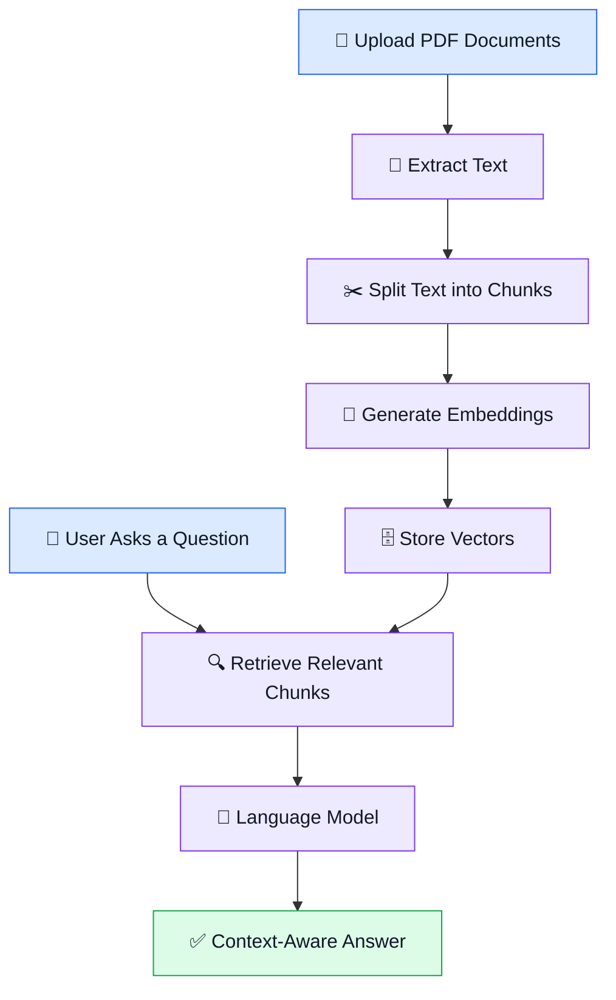

<div align="center">

# 📚 Multi-PDF Chatbot
### Chat with Your Documents Using AI 🤖

**Upload PDFs. Ask questions. Get context-aware answers.**

A document question-answering application powered by  
**Retrieval-Augmented Generation (RAG)**, Python, and Large Language Models.

<br/>


</div>

---

## 💡 About the Project

Ever wanted to ask questions directly from your study materials, notes, or research papers instead of searching through pages manually?

**Multi-PDF Chatbot** explores how AI can make document interaction easier. It allows users to ask natural-language questions about PDF documents and uses a RAG pipeline to retrieve relevant content before generating responses with a language model.

The project combines document processing, embeddings, vector search, and LLM integration in an interactive application.

## ✨ Key Features

| Feature | Description |
|---|---|
| 📄 PDF Processing | Extract text from PDF documents |
| 🧩 Text Chunking | Split extracted text into manageable sections |
| 🔎 Semantic Retrieval | Retrieve relevant content using embeddings and vector search |
| 💬 Question Answering | Ask questions about document content in natural language |
| 📝 Summarization | Explore document summarization features |
| 🖥️ Interactive Interface | Use a Streamlit-based interface |
| 🧪 Research Utilities | Supporting utilities for experimentation and evaluation |

*Feature availability depends on the current implementation and configuration.*

## ⚙️ How It Works

The application follows a Retrieval-Augmented Generation workflow.



### 🔍 What is RAG?

**Retrieval-Augmented Generation (RAG)** combines information retrieval with language generation.

Instead of relying only on a language model's existing knowledge, a RAG system retrieves relevant information from a supplied knowledge source and uses that context to formulate an answer.

This approach is useful for asking questions about specific documents.

## 🛠️ Tech Stack

- **Python** — application logic and document processing
- **Streamlit** — interactive user interface
- **LangChain** — components for building LLM and retrieval workflows
- **Hugging Face Sentence Transformers** — text embeddings
- **FAISS** — vector similarity search
- **Google Gemini / Groq** — language model integrations, where configured
- **PDF Processing Libraries** — text extraction from PDF files

## 🚀 Getting Started

Run the project locally using the following steps.

### 1. Clone the Repository

```bash
git clone https://github.com/omdattatraykorde/multi-pdf-chatbot-rag.git
cd multi-pdf-chatbot-rag
```

### 2. Create a Virtual Environment

**Windows — PowerShell**

```powershell
python -m venv .venv
.venv\Scripts\Activate.ps1
```

### 3. Install Dependencies

```bash
python -m pip install --upgrade pip
pip install -r requirements.txt
```

### 4. Configure API Keys

Create a `.env` file in the project root. Add the credentials required by the model provider configured in your application.

```env
GOOGLE_API_KEY=your_google_api_key
GROQ_API_KEY=your_groq_api_key
```

Replace the placeholders with your own API keys. Only configure providers supported by your code.

🔐 **Security tip:** Never upload your `.env` file, API keys, private documents, or sensitive user data to GitHub.

### 5. Launch the Application

```bash
streamlit run app.py
```

Open the local URL displayed in your terminal, usually:

`http://localhost:8501`

## 📂 Project Structure

```text
Multi_PDF_Chatbot/
├── app.py
├── components/
│   ├── chat.py
│   ├── dashboard.py
│   ├── navbar.py
│   ├── performance.py
│   ├── sidebar.py
│   └── summary.py
├── chat_history.py
├── experiment_manager.py
├── ingest.py
├── llm_factory.py
├── pdf_loader.py
├── rag.py
├── rag_chatbot.py
├── requirements.txt
├── research_evaluator.py
├── research_logger.py
├── retriever.py
├── suggestions.py
├── test_api.py
├── text_splitter.py
├── utils.py
├── vector_store.py
└── voice_input.py
```

## 🎯 What I Learned

Through this project, I explored:

- Building a document-based RAG application
- Preparing text for embedding and retrieval
- Using vector search to find relevant information
- Connecting Python applications with language models
- Developing an interactive application with Streamlit
- Organizing a multi-module Python project

## 🔮 Future Enhancements

- 📌 Display source references for generated answers
- 🎯 Improve retrieval quality and relevance ranking
- 📊 Evaluate retrieval and answer quality using suitable metrics
- 📁 Expand support for additional document formats
- ☁️ Deploy the application for public access

## 👨‍💻 Author

<div align="center">

### Om Korde
**Data Science Engineering Student**

Interested in AI, Machine Learning, Deep Learning, and Data Science.

[](https://github.com/omdattatraykorde)
[](https://www.linkedin.com/in/omkorde/)

</div>

---

<div align="center">

**Built to explore the intersection of document intelligence and Generative AI. 🚀**

</div>
